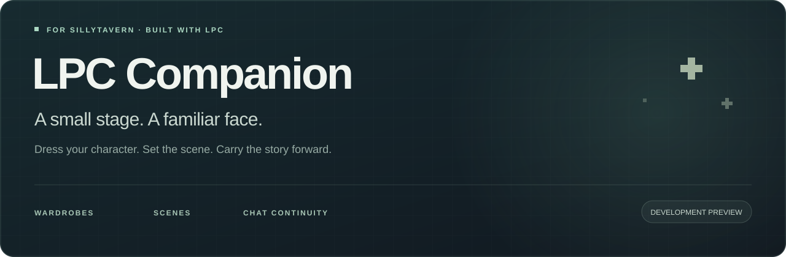
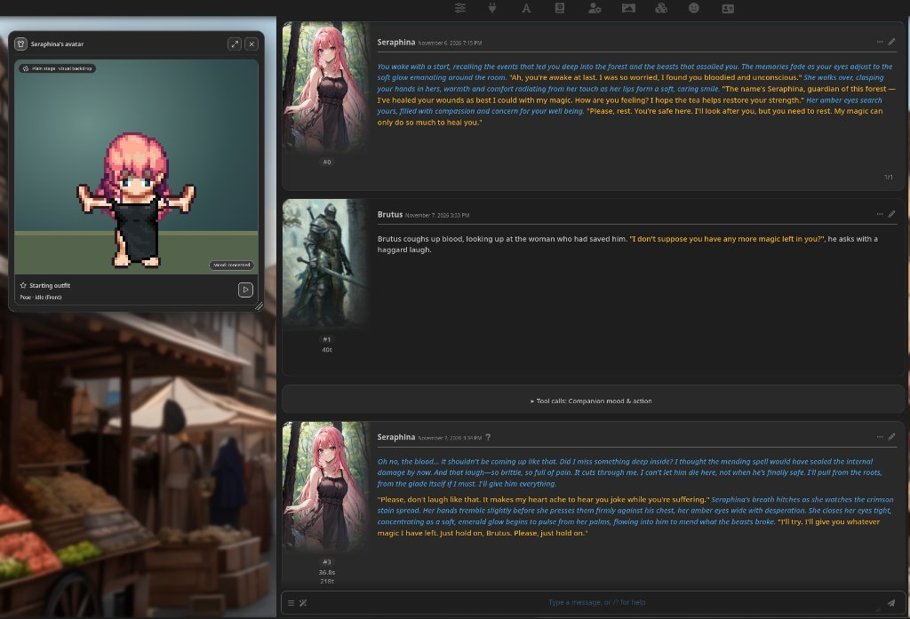
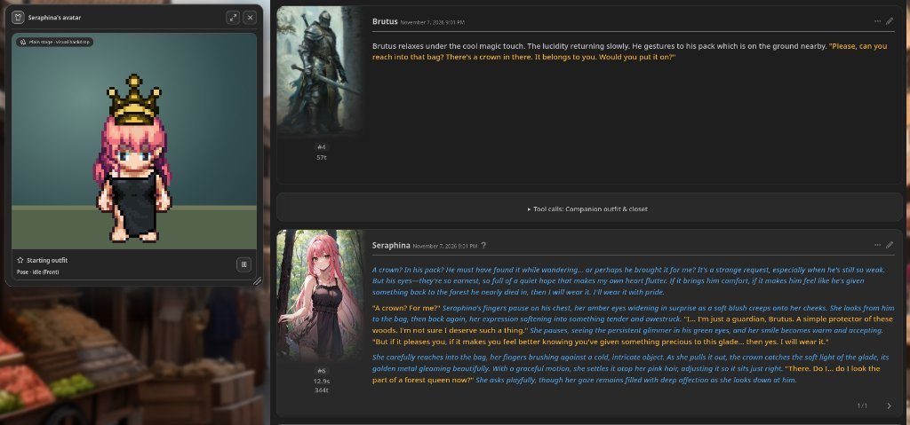
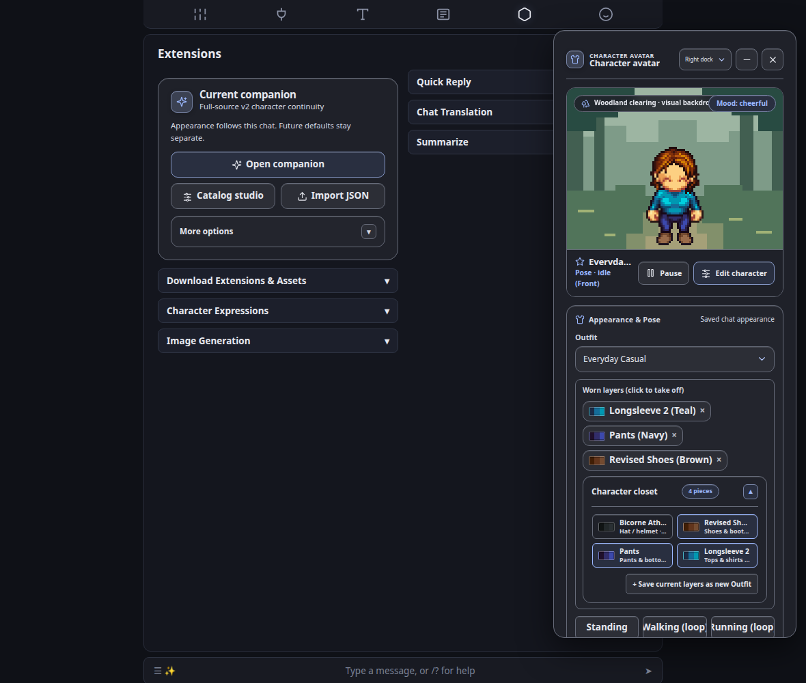
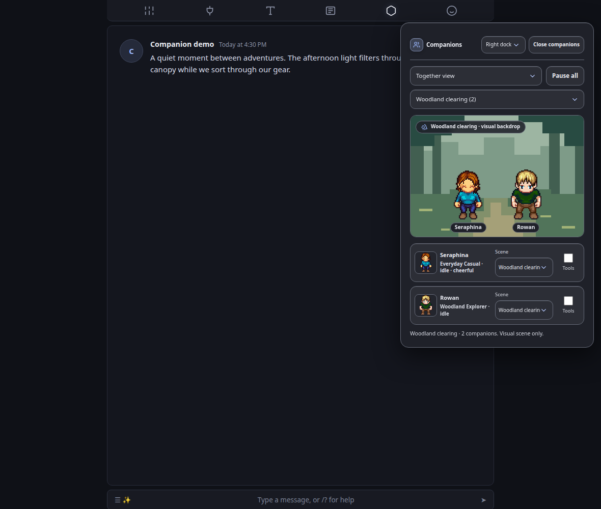
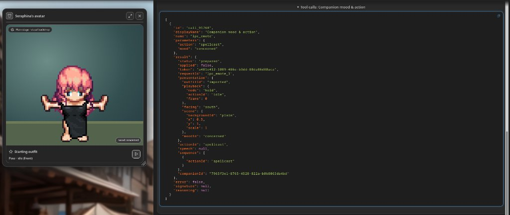
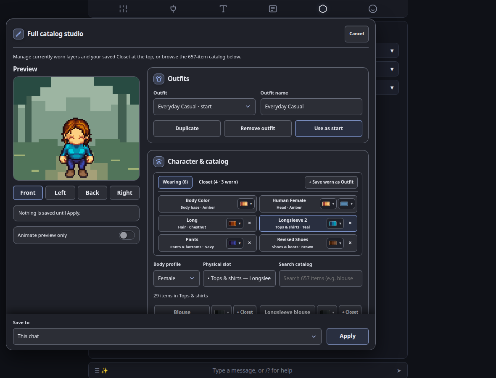

<div align="center">



# LPC Companion

**Give your SillyTavern characters a place beside the conversation.**

Named outfits · expressive poses · shared scenes · appearance that follows your chat

[Get started](#get-started) · [Import a character](#bring-your-generator-character) · [Things to know](#before-you-settle-in) · [LPC & credits](#made-possible-by-lpc)

</div>

LPC Companion brings layered pixel-art characters into SillyTavern. Build a look, save a wardrobe and give your companion a small scene to inhabit. When the conversation branches or you return to an older response, their accepted appearance follows that history.

Use the manual controls on their own, or opt into model tools for supported presentation changes. **No separate model subscription, extension-owned API credentials or server plugin is required for manual use.**

> **Development preview · `0.1.0-dev.38`**
>
> Tested on SillyTavern **1.19.0**. Install through SillyTavern’s **Extensions → Install extension** using the repository URL. Actual Android acceptance is still pending.

## Meet your companion

<table>
<tr>
<td width="50%"></td>
<td width="50%"></td>
</tr>
<tr>
<td><strong>Actions & moods in the flow of conversation.</strong><br>Your companion stays in a draggable, resizable Tamagotchi stage beside the chat, adopting expressions like <code>concerned</code> and performing looping or periodic actions like <code>spellcast</code> as the scene unfolds.</td>
<td><strong>A living character closet.</strong><br>Curate your character’s closet once—when the story calls for it, the companion can put on or take off individual layers (such as equipping a crown, <code>c01</code>) on the fly without manual micromanagement.</td>
</tr>
</table>

<table>
<tr>
<td width="50%"></td>
<td width="50%"></td>
</tr>
<tr>
<td><strong>Full inspector when you want control.</strong><br>Expand the panel anytime to toggle worn layers, manage your character closet with visual color swatches, switch named outfits, or trigger poses and sequences manually.</td>
<td><strong>A little company.</strong><br>Share a compact stage with up to two companions. Separate their scenes when the party splits.</td>
</tr>
</table>

<sub>Live roleplay and inspector captures in SillyTavern 1.19.0. Pixel art belongs to the credited LPC artists; see [artwork attribution](docs/UPSTREAM.md). Narrow screenshots elsewhere in this repository are desktop emulation, not Android acceptance.</sub>

### Built around the conversation

| Make it yours | Keep it consistent |
| --- | --- |
| **Full catalog studio & closet.** Search the pinned generator’s 657 definitions across 104 slots and six body profiles. Pick 3-tone color swatches, manage your Wearing / Closet bar, and save named outfits. | **A snapshot for each chat.** New chats copy defaults once. Existing chats keep their own appearance when defaults change. |
| **A small stage.** Woodland, hearth and courtyard backdrops, placement, scale and background lighting. | **History-aware appearance.** Branch, swipe or delete responses and reconcile to the accepted message chain. |
| **Expressive motion & poses.** 12 facial moods, held poses (sitting, sleeping/dozing, hands on hips), ongoing loops, and 15 brief emotes & actions with customizable main-panel repertoires. | **Preview, then Apply.** Browsing the catalog previews locally; invalid selections or failed preparation retain the last accepted presentation. |
| **Your SillyTavern theme & Tamagotchi view.** Inherited colors, fonts and sizing; a draggable, resizable Tamagotchi-style desktop window (`>= 701px`), compact mobile launcher, and responsive dock. | **Optional model controls.** The host’s provider can request supported updates; accepted responses authorize them. Manual controls stay available. |

The full catalog is a **pinned content library**, not a promise that every outfit can perform every animation. Actual layers determine what is available. [See the content contract and source gaps →](docs/USER_GUIDE.md)

## Get started

The loader permits **SillyTavern 1.18.0 and newer** for compatibility testing; **1.19.0 is the verified host baseline**. Compatibility testing on 1.18.0 is pending. Git must be available on the computer running SillyTavern for repository installation. You do not need Node/npm commands or a model backend to install and use the companion manually.

### 1. Install from the repository URL

Open **Extensions → Install extension**, paste this URL and choose **Install**:

```text
https://github.com/cremefriache/LPC-Companion
```

Choose a single-user or all-user installation as appropriate, then reload SillyTavern. Confirm **LPC Companion (development)** appears in **Manage Extensions**. The repository ships its compiled browser entry point, local artwork and notices; nothing needs to be built on your device.

The full artwork library makes the first download larger than a typical small extension. 

**Already using a manually copied build?** Export a recovery backup, disable the old LPC entry and keep only one installation active. A Git installation may use a different folder name from the old `lpc-companion` directory. Do not run both copies together or replace SillyTavern’s card/chat data. [Installation and updates →](docs/INSTALLATION.md)

### 2. Open a character chat

Select an ordinary character and open a chat, then go to **Extensions → LPC Companion**.

The welcome screen has no active companion workspace. If the extension appears installed but no controls are visible, open a character chat first.

### 3. Give them a look

On desktop viewports (`>= 701px`), a compact Tamagotchi-style card appears automatically — click **"Click here to setup {{char}}'s avatar"** (or choose **Set up companion** / **Catalog studio** in **Extensions → LPC Companion**) to open the Full catalog studio with a clothed starter character. Browse slots, pick 3-tone color swatches, add favorite pieces to your **Closet**, and customize which poses, moods, and actions appear on the main panel. Choose the save destination and explicitly **Apply**.

After setup, use the minimize (`—`) button to toggle between the full companion inspector and the compact Tamagotchi stage. You can drag the compact window by its header/stage, resize it from its bottom-right corner, or close it (`×`) to return to the launcher. On narrow/mobile screens (`<= 700px`), the launcher stays a compact floating circle icon.

**This chat** changes the current chat’s companion. **Future chats** changes the character defaults used when a new chat initializes. Preview and Cancel make no saved changes.

### 4. Optional model tool calling & SillyTavern settings

Manual controls always work without a model backend. If you want the AI model to update the avatar’s outfit, pose, mood, brief action, or stage during roleplay:

1. **In Extensions → LPC Companion**: Enable **Allow model tool calls**, choose a **Model tool scope** (`Character only` registers `lpc_outfit`, `lpc_pose`, and `lpc_emote`; `Character + Scene` adds `lpc_scene`), and toggle **Allow model controls** in the companion panel.
2. **In API Connections (plug icon 🔌, second from left on SillyTavern’s top bar)**:
   - **Prompt Post-Processing**: Keep set to **`None`** (default) or **`Merge consecutive roles (with tools)`**. Avoid *"No Tools"* or strict user-first post-processing modes, which rewrite tool-continuation or system messages into user turns.
3. **In AI Response Configuration (sliders icon on SillyTavern’s top bar)**:
   - **Enable function calling** (`function_calling: true`): Must be checked so SillyTavern passes registered tools to the backend.
   - **Max Response Length (tokens)** (`openai_max_tokens`): Set to at least **`1024`–`2048`** when using reasoning models (such as Gemma 4 via KoboldCpp), so thinking traces do not truncate before the tool call finishes.
   - **Request model reasoning** (`show_thoughts`): When enabled, if a model outputs a thought trace before calling a tool, SillyTavern retains that first message bubble to display the collapsible `[Thought for X seconds]` box above `Tool calls: ...` and places the character’s spoken reply in the message bubble below it. Unchecking **Request model reasoning** (`"show_thoughts": false`) lets SillyTavern automatically delete the pre-tool placeholder bubble so only a single character reply bubble appears.



<sub>An expanded <code>lpc_emote</code> tool call in SillyTavern: the model prepares a <code>concerned</code> mood and <code>spellcast</code> action (or equips/removes closet items via <code>lpc_outfit</code>), and the extension commits the update once the final response is accepted.</sub>

Prefer a source build or manual copy? The [development guide](docs/DEVELOPMENT.md) retains those instructions.

## Bring your generator character

Already have a look in the [Universal LPC character generator](https://liberatedpixelcup.github.io/Universal-LPC-Spritesheet-Character-Generator/)? Bring its **version 2 JSON export**, rather than a flattened sprite-sheet image.

1. Copy the generator’s JSON or save its `.json` export.
2. In the loaded character chat, choose **Import JSON** in LPC’s settings. You can also open **Full catalog studio → Import source package or generator JSON**.
3. Paste the JSON or use **Choose JSON file**, then preview it.
4. Review any compatibility diagnostics, choose where to save and **Apply**. Cancel keeps the accepted companion unchanged.



<sub>The current studio: sticky directional preview, unified Wearing / Closet wardrobe bar with 3-tone color swatches, 3-column slot/search toolbar, and a save bar that stays accessible while scrolling. Preview changes locally; nothing is saved until Apply.</sub>

The importer resolves choices against the **pinned local generator catalog**. The live website can move ahead of that pin; unknown assets, custom art, unavailable combinations and mismatched paths receive diagnostics. JSON does not grant permission to load arbitrary URLs or files.

To share an authored companion, use a configuration or complete companion package. Complete packages include verified selected artwork and the required credits/notices within the documented limits. Packages describe character defaults and starting presentation, rather than the entire chat history. [Package details →](docs/USER_GUIDE.md)

## Before you settle in

- **One writer per chat.** SillyTavern does not provide a general compare-and-swap save API. Avoid editing the same chat from two tabs/devices at once. Read-back verification and stale-context guards help, but do not create a server transaction.
- **Development, with a clear test boundary.** Desktop integration is verified on SillyTavern 1.19.0, commit `7e8663c`. Android’s actual-device checklist and performance budgets remain pending. Other host versions need their own acceptance.
- **Known cold-start delay.** Automatic blink preparation can delay the first curated render while opening the local artwork library. The desktop cold-composition performance gate remains open; this preview is not a completed performance release.
- **Animation depends on the outfit.** Missing art or unsupported source frames refuse the action; garments do not silently disappear to make it play. Full-source poses follow their authored views and layouts. This is presentation, not combat resolution or an inventory system.
- **Brief actions are transient.** They are bounded and do not replay after reload. Ongoing activities and accepted presentation follow history. Pause, hidden panels and reduced motion affect playback.
- **Model tools are opt-in.** They use SillyTavern’s configured provider. Global tool permission defaults off and is saved in this browser; enabling it allows companion controls when panels open. Closing a panel discards pending requests. Live provider acceptance covers the documented non-streaming Chat Completions setup; other providers and streaming modes remain unverified. A tool request alone does not save a change.
- **Keep backups before upgrading or downgrading.** Export a recovery backup and any complete companions you want to preserve. Older builds may reject newer fields, catalog IDs or package markers. Unreadable or ambiguous state blocks writes and offers recovery; history is bounded without silent pruning.
- **The launcher stays inside the page.** You can drag it with mouse or touch, but it is not an Android system overlay over other apps.

[Continuity & recovery](docs/USER_GUIDE.md) · [Update guide](docs/INSTALLATION.md) · [Android checklist](docs/USER_GUIDE.md) · [Verified release evidence](docs/STATUS.md)

## Made possible by LPC

**The characters are the work of the Liberated Pixel Cup community.** This extension brings their layered art and generator work into a conversation panel. It could not exist without the artists, maintainers and contributors who made those assets available.

### Give the upstream projects some love

- **[codyaboyd’s Universal LPC Modern Sprite Generator](https://github.com/codyaboyd/Universal-LPC-Modern-Sprite-Generator)** — the modern fork used for our original renderer extraction, curated character foundation and reviewed activity assets. Pinned to [`7736d76`](https://github.com/codyaboyd/Universal-LPC-Modern-Sprite-Generator/tree/7736d762aa2113f29342dad869ef4931218aa7ae).
- **[Universal LPC Spritesheet Character Generator](https://github.com/LiberatedPixelCup/Universal-LPC-Spritesheet-Character-Generator)** — the parent project and source of our complete pinned catalog, artwork paths, palettes and metadata. Pinned to [`86160e7`](https://github.com/LiberatedPixelCup/Universal-LPC-Spritesheet-Character-Generator/tree/86160e7507d6841259cff624a51a63c1d4847ee3). [Build a character in the live generator →](https://liberatedpixelcup.github.io/Universal-LPC-Spritesheet-Character-Generator/)
- **The LPC artists** — including bluecarrot16, JaidynReiman, Eliza Wyatt (ElizaWy), Benjamin K. Smith (BenCreating), Johannes Sjölund (wulax), Stephen Challener (Redshrike), Matthew Krohn (makrohn), Evert, TheraHedwig, MuffinElZangano, Durrani and many more. This is a small acknowledgement, not the complete attribution list; the per-item and per-path records are authoritative.
- **[SillyTavern](https://github.com/SillyTavern/SillyTavern)** — the host application and extension APIs this project integrates with.

Visit the upstream projects, star them if their work helps you, and credit the artists when sharing rendered characters. Please report companion integration issues here; upstream contributors are not responsible for this extension.

### Art and code have different licenses

Project code is licensed under **[GPL-3.0-only](LICENSE)**, matching the GPL-derived renderer, with corresponding source supplied. See the [repository notice](NOTICE.md) for scope and third-party exceptions. Artwork retains **its own per-item/per-path license choices**, authors, source URLs and required notices. There is no single blanket artwork license. Original repository-authored scene backdrops are separately MIT-licensed.

Open **Artwork & code credits** or **Full artwork credits** in the installed extension for readable attribution. Configuration and complete packages carry applicable credit records and full selected notices. A bare screenshot or PNG does not carry those records automatically.

[Upstream guide & attribution](docs/UPSTREAM.md) · [Artwork and code notices](assets/lpc/NOTICE.md) · [Curated credit records](assets/lpc/credits-data.json) · [Full-library provenance](vendor/lpc/full-catalog/provenance.json) · [GPL text](LICENSE)

## Explore further

| I want to… | Start here |
| --- | --- |
| Build, test or package the extension | [Development guide](docs/DEVELOPMENT.md) |
| Understand the catalog and explicit limitations | [Full catalog](docs/USER_GUIDE.md) · [Source gaps](docs/USER_GUIDE.md) |
| Use activities and brief action sequences | [Activities & sequences](docs/USER_GUIDE.md) · [Full-source controls](docs/USER_GUIDE.md) |
| Set up a second companion or group | [Companions & groups](docs/USER_GUIDE.md) · [Shared party scenes](docs/USER_GUIDE.md) |
| Understand theme, launcher or studio behavior | [Theme](docs/USER_GUIDE.md) · [Launcher](docs/USER_GUIDE.md) · [Studio](docs/USER_GUIDE.md) |
| Check what was actually tested | [Current content acceptance](docs/USER_GUIDE.md) · [Evidence](docs/STATUS.md) |
| Contribute a focused improvement | [Roadmap](CONTRIBUTING.md) · [Architecture](docs/DEVELOPMENT.md) |

Matching source, build instructions and complete artwork notices accompany this installation.

---

<div align="center">

Built for the quiet details that make a character feel present.<br>
<sub>Made with care for chat history, local rendering, and the people behind the pixels.</sub>

</div>

Brief actions and sequences repeat after a seven-second cooldown while their panel remains active, until stopped or replaced. Pause and hidden panels suspend playback. Repeats are page-local and do not resume after reload or a history/context change.
